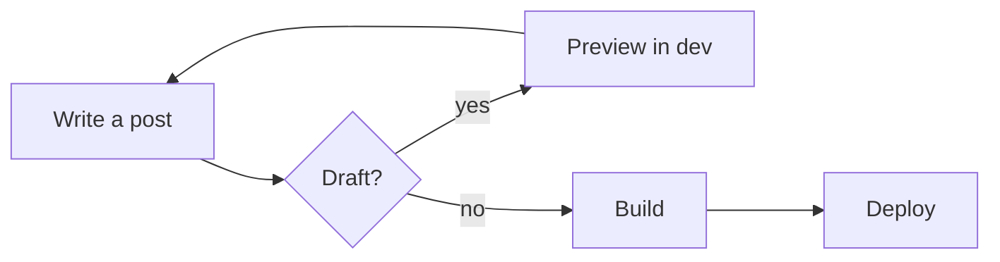
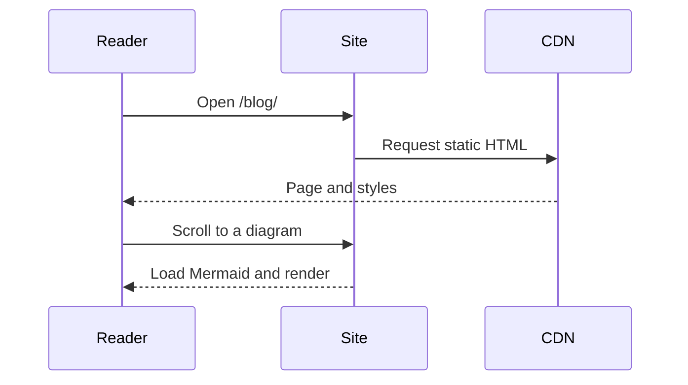

Write a fenced code block with the `mermaid` language and the post renders it as a diagram. Readers can zoom, pan, copy the source, or open it full screen, and the colors follow light and dark mode.

## A flowchart

## A sequence diagram

## How it works

A rehype plugin turns each `mermaid` block into a placeholder figure at build time. On pages that have one, the browser loads Mermaid and draws the diagram. Pages without diagrams don't download it at all.
